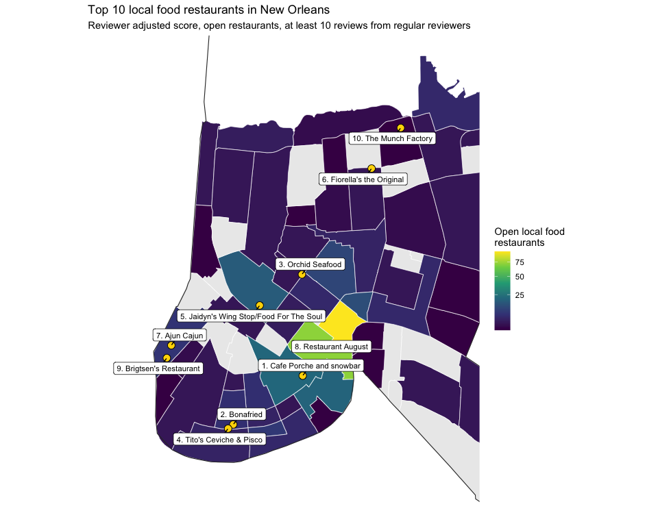
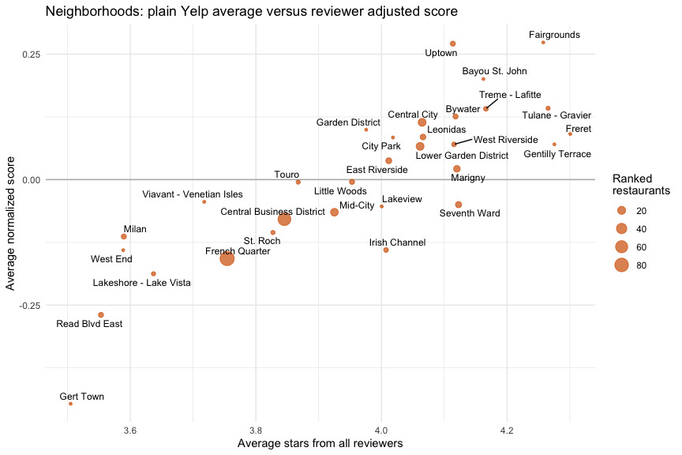

# Where to find the best local food in New Orleans

Math 167R, Project 2. Geonho Lee.

**Where can a visitor find the best local food in New Orleans (Cajun/Creole, Seafood and Southern restaurants), and which part of the city is the best place to look for it?**

**[Read the full report](yelp_new_orleans_project.md)** (renders right here on GitHub, with every table and map). The same report as one self contained HTML file is [`yelp_new_orleans_project.html`](yelp_new_orleans_project.html); download it to view it in a browser.

## Executive summary

Cajun/Creole, Seafood and Southern restaurants are 648 of the 2,259 New Orleans restaurants in the Yelp Open Dataset, 420 of them still open, and they get 52% of all New Orleans restaurant reviews. Rated by regular reviewers, each rating compared with that reviewer's own average, the best place to look is not the French Quarter, which has the most restaurants but ranks 28th of 31 neighborhoods. It is Central City, home of the top restaurant on the list and the best score of any neighborhood with more than ten ranked restaurants, with Uptown a short ride upriver. The exact top 10 moves when the reviewer rule changes; the neighborhood answer does not.

## Main findings

1. The French Quarter has the most local food restaurants (162) and by far the most reviews, and it ranks near the bottom of the city's neighborhoods both on the plain Yelp average (25 of 31) and after the reviewer adjustment (28 of 31).
2. Comparing each regular reviewer's rating with their own habits changes the top of the table. Freret, first on the plain average, drops to 9th, and Seventh Ward falls from 7th to 20th: their regulars gave them about what those regulars give everything. Uptown climbs from 11th to 2nd and Central City from 13th to 7th, the best of the neighborhoods with more than ten restaurants to choose from.
3. Only 5% of reviewers wrote five or more local food reviews, but they wrote 24% of all the reviews. Restaurants with fewer than ten reviews from these regulars jump around the ranking when one reviewer changes, so the top 10 uses a floor of ten regular reviews and shows the plain average next to the adjusted score.

## The top 10

| Rank | Restaurant | Neighborhood | Normalized score | Average stars | Reviews |
|---:|:---|:---|---:|---:|---:|
| 1 | Cafe Porche and snowbar | Central City | 0.76 | 4.83 | 176 |
| 2 | Bonafried | Uptown | 0.61 | 4.55 | 31 |
| 3 | Orchid Seafood | Bayou St. John | 0.60 | 4.48 | 33 |
| 4 | Tito's Ceviche & Pisco | Uptown | 0.59 | 4.72 | 221 |
| 5 | Jaidyn's Wing Stop/Food For The Soul | Mid-City | 0.59 | 4.58 | 60 |
| 6 | Fiorella's the Original | Gentilly Terrace | 0.53 | 4.44 | 133 |
| 7 | Ajun Cajun | Leonidas | 0.53 | 4.63 | 51 |
| 8 | Restaurant August | Central Business District | 0.52 | 4.45 | 1,350 |
| 9 | Brigtsen's Restaurant | Leonidas | 0.51 | 4.54 | 353 |
| 10 | The Munch Factory | Pontchartrain Park | 0.48 | 4.55 | 22 |

Open restaurants inside a New Orleans neighborhood with at least 10 reviews from regular reviewers (people with 5 or more local food reviews), ranked by how far above their usual rating those regulars scored the place. Average stars and review counts are from all reviewers in the dataset.





## What the report does

1. Reads the two big Yelp json files and keeps New Orleans restaurants and their reviews (`R/import.R`).
2. Splits the category labels, shows that Cajun/Creole, Seafood and Southern overlap, and keeps restaurants with at least one of the three: 648 restaurants.
3. Joins the 248,426 reviews for those restaurants.
4. Checks the Yelp city label against the official city polygon: 632 of 648 are inside.
5. Compares three ways to cut the city, ZIP codes, census tracts and the city's 72 Neighborhood Statistical Areas, and picks the neighborhoods.
6. Rates every open restaurant two ways, with all reviewers and with regular reviewers compared against their own average, tests the reviewer threshold, and ranks the neighborhoods.
7. Gives the top 10, the map, and the neighborhood to go to.

## Files

| Path | What it is |
|---|---|
| `yelp_new_orleans_project.qmd` | the report source |
| `yelp_new_orleans_project.md` | the rendered report, readable on GitHub |
| `yelp_new_orleans_project.html` | the rendered report as one self contained HTML file |
| `yelp_new_orleans_project_files/` | the figures the rendered report uses |
| `R/import.R` | reads the raw json files once and saves the New Orleans rds files |
| `R/boundaries.R` | downloads the boundary layers once and saves them |
| `data/new_orleans/business_new_orleans.rds` | the 2,259 New Orleans restaurants |
| `data/new_orleans/reviews_new_orleans_no_text.rds` | their 476,421 reviews, without the review text |
| `data/boundaries/` | Louisiana places, Orleans Parish tracts, 701 ZCTAs and the Neighborhood Statistical Areas |
| `ai_prompts.md` | the AI prompts I used on this project |
| `.gitignore` | keeps `data/raw/` and the reviews with text out of the repo |

## Getting the data

1. Download the Yelp Open Dataset from <https://business.yelp.com/data/resources/open-dataset/>. It is one file of about 4 GB; you fill in a short form and agree to the license first.
2. Unpack it (about 9 GB) and put `yelp_academic_dataset_business.json` and `yelp_academic_dataset_review.json` in `data/raw/`.
3. Run `R/import.R` once. It takes about 6 minutes and writes `data/new_orleans/`.

The raw json files are not in this repo. They are far over GitHub's file size limit and Yelp's license does not allow passing the dataset on, so `data/raw/` is in `.gitignore`. The report runs from the two small rds files, which are committed. The report's section "How I handled the large files" has the details.

## How to run it

You need R, RStudio (Quarto comes with it) and these packages:

```r
install.packages(c("tidyverse", "jsonlite", "lubridate", "sf", "tigris",
                   "scales", "viridis", "ggrepel"))
```

The rds files and the boundary layers are committed, so the report renders without the raw data: open the project, then in the Terminal run

```
quarto render yelp_new_orleans_project.qmd
```

which writes both the `.md` and the `.html`. `R/boundaries.R` only needs to run again if you want fresh boundary files; it downloads the Census layers through `tigris` and the Neighborhood Statistical Areas from Data.NOLA.gov.
