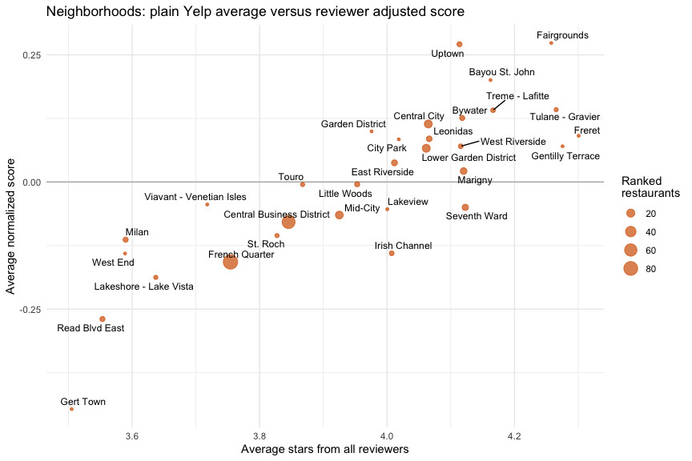
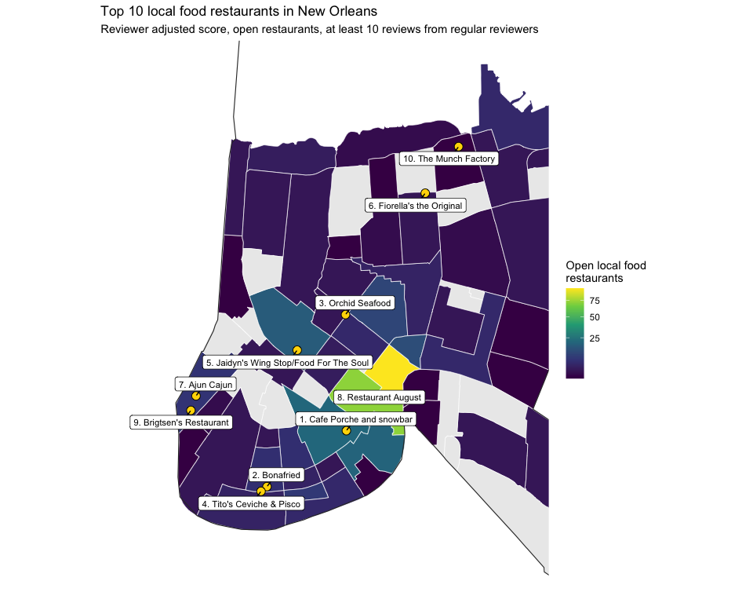

# Where to find the best local food in New Orleans
Geonho Lee
2026-11-15

- [The question](#the-question)
- [Step 1 and 2: import and filter](#step-1-and-2-import-and-filter)
- [Step 3: pick the restaurant
  categories](#step-3-pick-the-restaurant-categories)
  - [Why these three](#why-these-three)
  - [Do they actually appear
    together?](#do-they-actually-appear-together)
  - [Inclusion rule](#inclusion-rule)
- [Step 4: join the reviews](#step-4-join-the-reviews)
- [Step 5: check the city label against the real city
  boundary](#step-5-check-the-city-label-against-the-real-city-boundary)
- [Step 6: choose and defend a geographic
  area](#step-6-choose-and-defend-a-geographic-area)
  - [What the table says](#what-the-table-says)
  - [My choice: Neighborhood Statistical
    Areas](#my-choice-neighborhood-statistical-areas)
  - [Neighborhoods ranked by local food
    restaurants](#neighborhoods-ranked-by-local-food-restaurants)
- [Step 7: ratings from all reviewers, then from regular
  reviewers](#step-7-ratings-from-all-reviewers-then-from-regular-reviewers)
  - [Plain averages, every reviewer counted the
    same](#plain-averages-every-reviewer-counted-the-same)
  - [Regular reviewers](#regular-reviewers)
  - [Each reviewer’s own baseline](#each-reviewers-own-baseline)
  - [Raw versus reviewer adjusted, restaurant by
    restaurant](#raw-versus-reviewer-adjusted-restaurant-by-restaurant)
  - [Neighborhoods, raw versus
    adjusted](#neighborhoods-raw-versus-adjusted)
  - [Does the threshold change the
    answer?](#does-the-threshold-change-the-answer)
- [The answer](#the-answer)
  - [Top 10 local food restaurants](#top-10-local-food-restaurants)
  - [Which part of the city](#which-part-of-the-city)
- [How I handled the large files](#how-i-handled-the-large-files)
- [Limitations](#limitations)
- [Packages](#packages)

## The question

Where can a visitor find the best local food in New Orleans
(Cajun/Creole, Seafood and Southern restaurants), and which part of the
city is the best place to look for it?

I picked local food because that is what people actually come to New
Orleans to eat. Steps 1 to 6 find the restaurants, pick the categories,
join the reviews and choose how to cut the city into areas. Step 7 rates
the restaurants two ways, once with every reviewer and once with only
the regular reviewers, each compared with their own habits. The answer
at the end is a top 10 and a map of where they are, plus the
neighborhood I would send a visitor to.

## Step 1 and 2: import and filter

The import is in [`R/import.R`](R/import.R). It reads the two Yelp json
files with `stream_in()`, keeps businesses in New Orleans, LA whose
categories include “Restaurants”, and saves the result as rds. The
review file is 5 GB, so that one is read 20,000 lines at a time and only
the rows for New Orleans restaurants are kept. The section “How I
handled the large files” near the end has the details and the import
code.

``` r
restaurants <- readRDS("data/new_orleans/business_new_orleans.rds")
reviews <- readRDS("data/new_orleans/reviews_new_orleans_no_text.rds")

dim(restaurants)
```

    [1] 2259   13

``` r
dim(reviews)
```

    [1] 476421      7

2,259 restaurants and 476,421 reviews. Every restaurant has a latitude
and longitude, which matters for the maps later.

## Step 3: pick the restaurant categories

The `categories` column is one string with commas in it, so first I
split it into one row per restaurant and category.

``` r
restaurant_categories <- restaurants |>
  select(business_id, categories) |>
  separate_rows(categories, sep = ",") |>
  mutate(category = str_to_lower(str_squish(categories))) |>
  select(business_id, category) |>
  distinct()

category_counts <- restaurant_categories |>
  count(category, sort = TRUE)

category_counts |>
  filter(category != "restaurants") |>
  slice_head(n = 20) |>
  kable(col.names = c("Category", "Restaurants"))
```

| Category                  | Restaurants |
|:--------------------------|------------:|
| food                      |         725 |
| nightlife                 |         540 |
| bars                      |         508 |
| cajun/creole              |         401 |
| breakfast & brunch        |         367 |
| sandwiches                |         354 |
| seafood                   |         331 |
| american (new)            |         323 |
| american (traditional)    |         299 |
| coffee & tea              |         208 |
| burgers                   |         202 |
| cafes                     |         173 |
| pizza                     |         172 |
| cocktail bars             |         160 |
| event planning & services |         156 |
| southern                  |         155 |
| fast food                 |         142 |
| mexican                   |         124 |
| salad                     |         124 |
| italian                   |         121 |

“Restaurants” is on every row because that is how I filtered, so I
dropped it from the table. After that the biggest categories are things
like food, nightlife and bars, which are not really cuisines. The first
real cuisine is cajun/creole at number 5, and seafood and southern are
not far behind.

### Why these three

Cajun/Creole, Seafood and Southern are the three categories that
describe New Orleans food. Gumbo, po-boys, crawfish, red beans and rice,
fried catfish all land in one or more of these. They also overlap a lot
in real life: a Cajun place usually serves seafood, and a lot of seafood
places call themselves Southern.

``` r
selected_categories <- c("cajun/creole", "seafood", "southern")

category_counts |>
  filter(category %in% selected_categories) |>
  kable(col.names = c("Category", "Restaurants"))
```

| Category     | Restaurants |
|:-------------|------------:|
| cajun/creole |         401 |
| seafood      |         331 |
| southern     |         155 |

### Do they actually appear together?

``` r
selected_wide <- restaurant_categories |>
  filter(category %in% selected_categories) |>
  mutate(has = TRUE) |>
  pivot_wider(names_from = category, values_from = has, values_fill = FALSE)

pair_counts <- tribble(
  ~pair, ~restaurants,
  "cajun/creole + seafood",  sum(selected_wide$`cajun/creole` & selected_wide$seafood),
  "cajun/creole + southern", sum(selected_wide$`cajun/creole` & selected_wide$southern),
  "seafood + southern",      sum(selected_wide$seafood & selected_wide$southern),
  "all three",               sum(selected_wide$`cajun/creole` & selected_wide$seafood & selected_wide$southern)
)

kable(pair_counts, col.names = c("Categories", "Restaurants with both"))
```

| Categories              | Restaurants with both |
|:------------------------|----------------------:|
| cajun/creole + seafood  |                   156 |
| cajun/creole + southern |                    72 |
| seafood + southern      |                    45 |
| all three               |                    34 |

``` r
how_many <- selected_wide |>
  mutate(n_selected = `cajun/creole` + seafood + southern) |>
  count(n_selected)

kable(how_many, col.names = c("How many of the three", "Restaurants"))
```

| How many of the three | Restaurants |
|----------------------:|------------:|
|                     1 |         443 |
|                     2 |         171 |
|                     3 |          34 |

156 restaurants are tagged both cajun/creole and seafood, so the overlap
is real. 205 restaurants have at least two of the three tags. That is
the evidence the three belong in one group.

### Inclusion rule

A restaurant is in my group if it has **at least one** of the three
categories. Requiring two would throw out most of the plain seafood
places and plain Southern places, and those are exactly the kind of
restaurant a visitor is looking for.

``` r
selected_restaurants <- restaurants |>
  semi_join(selected_wide, by = "business_id")

n_selected <- nrow(selected_restaurants)
n_open <- sum(selected_restaurants$is_open == 1)
```

That gives 648 local food restaurants, 420 of them still open according
to Yelp. That is 29% of all New Orleans restaurants in the dataset. I
keep the closed ones for the counts and maps in this part, since the
question for step 6 is where local food restaurants are, not where to
eat tonight.

## Step 4: join the reviews

Filter the reviews down to the selected restaurants first, then join. No
reason to carry the other 476,421 reviews around.

``` r
local_reviews <- reviews |>
  semi_join(selected_restaurants, by = "business_id") |>
  mutate(review_date = ymd_hms(date), review_year = year(review_date))

reviews_per_restaurant <- local_reviews |>
  count(business_id, name = "reviews_in_dataset")

selected_restaurants <- selected_restaurants |>
  left_join(reviews_per_restaurant, by = "business_id") |>
  mutate(reviews_in_dataset = replace_na(reviews_in_dataset, 0))

summary(selected_restaurants$reviews_in_dataset)
```

       Min. 1st Qu.  Median    Mean 3rd Qu.    Max. 
       5.00   28.75  115.00  383.37  395.25 7673.00 

248,426 reviews from 138,073 reviewers, from 2005 to 2022. That is 52%
of all the New Orleans restaurant reviews, for 29% of the restaurants.
Local food places get reviewed more than average.

One check: Yelp’s own `review_count` column counts all reviews ever,
while the dataset only includes a subset of them.

``` r
review_check <- selected_restaurants |>
  summarise(
    yelp_review_count = sum(review_count),
    reviews_in_dataset = sum(reviews_in_dataset),
    ratio = reviews_in_dataset / yelp_review_count
  )

kable(review_check, digits = 2)
```

| yelp_review_count | reviews_in_dataset | ratio |
|------------------:|-------------------:|------:|
|            243635 |             248426 |  1.02 |

The two are close (ratio 1.02), so the review file and the business file
were taken at about the same time. I use the dataset count from here on
because those are the reviews I can actually look at.

## Step 5: check the city label against the real city boundary

Yelp’s `city` column is typed in by whoever created the listing. The
census has an official polygon for New Orleans. A spatial join tells me
which restaurants labeled “New Orleans” are actually inside it. The
boundary files were downloaded once with
[`R/boundaries.R`](R/boundaries.R) and saved as rds.

``` r
louisiana_places <- readRDS("data/boundaries/louisiana_places.rds") |> st_transform(4326)
new_orleans_boundary <- louisiana_places |> filter(place_name == "New Orleans")

restaurant_points <- selected_restaurants |>
  st_as_sf(coords = c("longitude", "latitude"), crs = 4326, remove = FALSE)

restaurants_with_place <- restaurant_points |>
  st_join(louisiana_places, join = st_within, left = TRUE)

restaurants_with_place |>
  st_drop_geometry() |>
  count(city, place_name, sort = TRUE) |>
  kable(col.names = c("Yelp city", "Census place the point is in", "Restaurants"))
```

| Yelp city   | Census place the point is in | Restaurants |
|:------------|:-----------------------------|------------:|
| New Orleans | New Orleans                  |         632 |
| New Orleans | Harahan                      |           4 |
| New Orleans | Jefferson                    |           4 |
| New Orleans | Elmwood                      |           2 |
| New Orleans | Arabi                        |           1 |
| New Orleans | Gretna                       |           1 |
| New Orleans | Harvey                       |           1 |
| New Orleans | Kenner                       |           1 |
| New Orleans | Metairie                     |           1 |
| New Orleans | River Ridge                  |           1 |

``` r
n_inside <- sum(restaurants_with_place$place_name == "New Orleans", na.rm = TRUE)
n_outside <- n_selected - n_inside
```

``` r
outside_places <- restaurants_with_place |>
  st_drop_geometry() |>
  filter(is.na(place_name) | place_name != "New Orleans") |>
  mutate(place_name = replace_na(place_name, "none")) |>
  count(place_name, sort = TRUE)

outside_named <- outside_places |> filter(place_name != "none")
n_no_place <- sum(outside_places$n[outside_places$place_name == "none"])
outside_text <- paste0(outside_named$place_name, " (", outside_named$n, ")", collapse = ", ")
```

632 of the 648 are inside the official New Orleans boundary. The other
16 say “New Orleans” on Yelp but the pin lands in Harahan (4), Jefferson
(4), Elmwood (2), Arabi (1), Gretna (1), Harvey (1), Kenner (1),
Metairie (1), River Ridge (1). Those are suburbs that use a New Orleans
mailing address, so the pin is probably right and the city label is just
loose. They stay in the dataset, but for the geographic comparison I
only count restaurants inside the city, since that is the question.

``` r
ggplot() +
  geom_sf(data = new_orleans_boundary, fill = "grey95", color = "grey35") +
  geom_sf(
    data = restaurants_with_place |> filter(place_name == "New Orleans"),
    aes(color = stars), alpha = 0.7, size = 1.6
  ) +
  scale_color_viridis_c(option = "C", limits = c(1, 5)) +
  labs(title = "Local food restaurants inside New Orleans", color = "Yelp\nstars") +
  theme_minimal()
```


Almost all the dots are packed into the bend of the river on the west
side: the French Quarter and CBD, then a thinner line going uptown. The
whole eastern half of the city, which is mostly New Orleans East and the
wetlands, has a handful.

## Step 6: choose and defend a geographic area

The question is “which part of the city”, so I need to cut the city into
parts. There is no one right way to do that. I compared three:

- **ZIP codes (ZCTAs)**, from the census. People know their ZIP code,
  but ZIPs were drawn for mail routes and some cover several very
  different neighborhoods.
- **Census tracts**, also from the census. Drawn to hold a few thousand
  people each, so they are small and even, but they only have numbers
  for names.
- **Neighborhood Statistical Areas (NSAs)**, from the City of New
  Orleans open data site. Named neighborhoods like French Quarter,
  Marigny, Bywater, Garden District.

``` r
zctas <- readRDS("data/boundaries/zctas_701.rds") |> st_transform(4326)
tracts <- readRDS("data/boundaries/orleans_tracts.rds") |> st_transform(4326)
neighborhoods <- readRDS("data/boundaries/neighborhoods.rds") |> st_transform(4326)

# the neighborhood file's name column
nsa_name_col <- intersect(c("gnocdc_lab", "GNOCDC_LAB", "neighborhood", "NEIGHBORHOOD", "name", "NAME"), names(neighborhoods))[1]
if (is.na(nsa_name_col)) nsa_name_col <- names(neighborhoods)[sapply(neighborhoods, is.character)][1]
neighborhoods <- neighborhoods |> rename(area_name = all_of(nsa_name_col))
# the file has the names in all caps
neighborhoods <- neighborhoods |> mutate(area_name = str_to_title(area_name))

# ZCTAs cover the suburbs too, keep only the ones that touch the city
zctas <- zctas |> filter(lengths(st_intersects(zctas, new_orleans_boundary)) > 0)

zctas <- zctas |> mutate(area_name = zcta) |> select(area_name)
tracts <- tracts |> mutate(area_name = paste("Tract", tract_name)) |> select(area_name)
neighborhoods <- neighborhoods |> select(area_name)

city_points <- restaurants_with_place |> filter(place_name == "New Orleans")
```

The same join for each system. For every restaurant inside the city,
find which area it is in, then count by area.

``` r
summarise_system <- function(points, areas, system_name) {
  joined <- points |>
    st_join(areas, join = st_within, left = TRUE) |>
    st_drop_geometry()

  per_area <- areas |>
    st_drop_geometry() |>
    left_join(
      joined |>
        filter(!is.na(area_name)) |>
        group_by(area_name) |>
        summarise(
          restaurants = n(),
          average_stars = mean(stars),
          reviews = sum(reviews_in_dataset),
          .groups = "drop"
        ),
      by = "area_name"
    ) |>
    mutate(restaurants = replace_na(restaurants, 0L), reviews = replace_na(reviews, 0L))

  tibble(
    system = system_name,
    areas = nrow(areas),
    restaurants_assigned = sum(!is.na(joined$area_name)),
    unmatched = sum(is.na(joined$area_name)),
    areas_with_none = sum(per_area$restaurants == 0),
    areas_with_5_or_more = sum(per_area$restaurants >= 5),
    smallest = min(per_area$restaurants),
    largest = max(per_area$restaurants),
    per_area = list(per_area)
  )
}

comparison <- bind_rows(
  summarise_system(city_points, zctas, "ZIP code (ZCTA)"),
  summarise_system(city_points, tracts, "Census tract"),
  summarise_system(city_points, neighborhoods, "Neighborhood (NSA)")
)

comparison |>
  select(-per_area) |>
  kable(col.names = c("Geographic system", "Areas", "Restaurants assigned", "Unmatched", "Areas with 0", "Areas with 5+", "Smallest", "Largest"))
```

| Geographic system | Areas | Restaurants assigned | Unmatched | Areas with 0 | Areas with 5+ | Smallest | Largest |
|:---|---:|---:|---:|---:|---:|---:|---:|
| ZIP code (ZCTA) | 21 | 632 | 0 | 4 | 16 | 0 | 212 |
| Census tract | 184 | 632 | 0 | 76 | 29 | 0 | 111 |
| Neighborhood (NSA) | 72 | 632 | 0 | 18 | 28 | 0 | 162 |

``` r
cmp <- comparison |> select(-per_area)
zip_row <- cmp |> filter(system == "ZIP code (ZCTA)")
tract_row <- cmp |> filter(system == "Census tract")
nsa_row <- cmp |> filter(system == "Neighborhood (NSA)")
```

### What the table says

ZIP codes: only 21 areas, and the biggest one has 212 restaurants. That
is too coarse. Telling someone “go to 70130” is not useful, that ZIP
covers the CBD, the Warehouse District and the Lower Garden District,
which are different places to eat.

Census tracts: 184 areas, so the opposite problem. 76 tracts have no
local food restaurant at all and only 29 have five or more. Most of the
comparisons would be between tracts with one or two restaurants, which
is noise. And nobody knows what “Tract 133” is.

Neighborhoods: 72 areas, 28 of them with five or more restaurants,
biggest one 162. The names mean something to a visitor and to anyone
from here. Unmatched points are 0, so the boundaries cover the city
fine.

``` r
count_maps <- bind_rows(
  zctas |> left_join(comparison$per_area[[1]], by = "area_name") |> mutate(system = "ZIP code (ZCTA)"),
  tracts |> left_join(comparison$per_area[[2]], by = "area_name") |> mutate(system = "Census tract"),
  neighborhoods |> left_join(comparison$per_area[[3]], by = "area_name") |> mutate(system = "Neighborhood (NSA)")
) |>
  mutate(
    restaurants = replace_na(restaurants, 0L),
    system = factor(system, levels = c("ZIP code (ZCTA)", "Census tract", "Neighborhood (NSA)"))
  )

bbox <- st_bbox(new_orleans_boundary)

ggplot(count_maps) +
  geom_sf(aes(fill = restaurants), color = "white", linewidth = 0.15) +
  geom_sf(data = new_orleans_boundary, fill = NA, color = "grey20", linewidth = 0.4) +
  scale_fill_viridis_c(trans = "sqrt", option = "D") +
  coord_sf(xlim = c(bbox["xmin"], bbox["xmax"]), ylim = c(bbox["ymin"], bbox["ymax"])) +
  facet_wrap(~system, nrow = 1) +
  labs(title = "Where the local food restaurants are, three ways to cut the city", fill = "Restaurants") +
  theme_minimal() +
  theme(axis.text = element_blank(), panel.grid = element_blank(), legend.position = "bottom", legend.key.width = unit(1.5, "cm"))
```


Same data, three pictures. The ZIP map is a few big blobs. The tract map
is a mosaic where most pieces are empty. The neighborhood map shows the
pattern at the scale people talk about: one bright strip along the river
from the French Quarter through the CBD and into the Lower Garden
District, fading out going uptown, and almost nothing east of the
Industrial Canal.

### My choice: Neighborhood Statistical Areas

I am going with the neighborhoods for the main analysis. Reasons, in
order:

1.  They match the question. “Which part of the city” is a neighborhood
    question. A visitor asks “should I go to the Quarter or Uptown”, not
    “should I go to tract 133 or tract 137”.
2.  The areas are the right size. 28 neighborhoods have at least five
    restaurants, which is enough to compare averages without one
    restaurant swinging the whole area. ZIPs are too few and tracts are
    too many.
3.  The names are documented. The city publishes the boundaries and the
    names are the ones on neighborhood association signs and in local
    news.
4.  Nothing falls through. 0 restaurants inside the city are unmatched.

What the choice hides: a neighborhood like Uptown or the CBD is still
big enough that the best street inside it matters, and the map cannot
show that. Also a few neighborhoods have one or two restaurants and
their average rating will be unreliable. I flag those in the table below
and will leave them out of the final ranking.

The requirement was at least 10 restaurants in at least 7 different
areas. Under neighborhoods that is 54 areas with at least one restaurant
and 28 with five or more, so it clears easily.

### Neighborhoods ranked by local food restaurants

``` r
neighborhood_table <- comparison$per_area[[3]] |>
  filter(restaurants > 0) |>
  arrange(desc(restaurants)) |>
  mutate(average_stars = round(average_stars, 2))

neighborhood_table |>
  slice_head(n = 15) |>
  kable(col.names = c("Neighborhood", "Restaurants", "Average stars", "Reviews in dataset"))
```

| Neighborhood              | Restaurants | Average stars | Reviews in dataset |
|:--------------------------|------------:|--------------:|-------------------:|
| French Quarter            |         162 |          3.67 |              97219 |
| Central Business District |         115 |          3.71 |              59770 |
| Lower Garden District     |          37 |          3.77 |              14819 |
| Central City              |          34 |          3.90 |               7492 |
| Mid-City                  |          24 |          3.88 |               8289 |
| Marigny                   |          20 |          3.98 |               6151 |
| Leonidas                  |          17 |          4.00 |               5411 |
| Seventh Ward              |          12 |          4.29 |               1662 |
| East Riverside            |          11 |          3.82 |               6100 |
| Uptown                    |          11 |          4.09 |               2002 |
| Bywater                   |          11 |          4.09 |               4360 |
| Treme - Lafitte           |           9 |          4.17 |               5329 |
| Tulane - Gravier          |           9 |          3.78 |                833 |
| Touro                     |           8 |          3.81 |               2796 |
| Milan                     |           8 |          3.69 |                525 |

``` r
top_nb <- neighborhood_table |> slice_head(n = 3)
```

French Quarter has the most local food restaurants (162), then Central
Business District (115) and Lower Garden District (37). Count is not the
same as quality though. The next map shows the average Yelp rating by
neighborhood, only for neighborhoods with at least five restaurants so
one place cannot drive the color.

``` r
rating_map <- neighborhoods |>
  left_join(comparison$per_area[[3]], by = "area_name") |>
  mutate(average_stars_shown = if_else(restaurants >= 5, average_stars, NA_real_))

ggplot() +
  geom_sf(data = rating_map, aes(fill = average_stars_shown), color = "white", linewidth = 0.2) +
  geom_sf(data = new_orleans_boundary, fill = NA, color = "grey20", linewidth = 0.4) +
  scale_fill_viridis_c(option = "C", na.value = "grey88", limits = c(3, 5)) +
  coord_sf(xlim = c(bbox["xmin"], bbox["xmax"]), ylim = c(bbox["ymin"], bbox["ymax"])) +
  labs(title = "Average rating of local food restaurants by neighborhood", fill = "Average\nstars") +
  theme_minimal() +
  theme(axis.text = element_blank(), panel.grid = element_blank())
```


``` r
best_rated <- neighborhood_table |>
  filter(restaurants >= 5) |>
  arrange(desc(average_stars)) |>
  slice_head(n = 5)

kable(best_rated, col.names = c("Neighborhood", "Restaurants", "Average stars", "Reviews in dataset"))
```

| Neighborhood    | Restaurants | Average stars | Reviews in dataset |
|:----------------|------------:|--------------:|-------------------:|
| Freret          |           5 |          4.30 |               1047 |
| Seventh Ward    |          12 |          4.29 |               1662 |
| Treme - Lafitte |           9 |          4.17 |               5329 |
| Uptown          |          11 |          4.09 |               2002 |
| Bywater         |          11 |          4.09 |               4360 |

``` r
fq_stars <- neighborhood_table$average_stars[neighborhood_table$area_name == "French Quarter"]
fq_rank <- which(arrange(filter(neighborhood_table, restaurants >= 5), desc(average_stars))$area_name == "French Quarter")
```

Among neighborhoods with at least five local food restaurants, Freret
has the highest average at 4.3 stars, with only 5 restaurants, so one
new place could move it. Seventh Ward (12 restaurants) and Treme -
Lafitte (9) are right behind. The big purple block in the east is one
huge neighborhood with just enough restaurants to get a color, which
says more about how big the area is than about the food. The French
Quarter, with the most restaurants by far, is only number 23 of 28 at
3.67 stars. Tourist areas get a lot of reviews but not the best ones.

These are plain Yelp averages. Step 7 redoes this with reviewer adjusted
scores and checks whether the ranking holds.

## Step 7: ratings from all reviewers, then from regular reviewers

From here on the question is “where to eat”, so I only rank restaurants
that Yelp lists as open. The reviews of the closed ones still count for
one thing: a reviewer’s habits. If someone reviewed six local food
places and two have since closed, all six reviews say something about
how that person rates.

``` r
open_restaurants <- selected_restaurants |> filter(is_open == 1)
```

### Plain averages, every reviewer counted the same

``` r
all_reviewer_summary <- local_reviews |>
  group_by(business_id) |>
  summarise(
    number_of_reviews_all_reviewers = n(),
    average_stars_all_reviewers = mean(stars),
    median_stars_all_reviewers = median(stars),
    .groups = "drop"
  )

all_reviewer_summary |>
  semi_join(open_restaurants, by = "business_id") |>
  left_join(open_restaurants |> select(business_id, business_name), by = "business_id") |>
  filter(number_of_reviews_all_reviewers >= 20) |>
  arrange(desc(average_stars_all_reviewers)) |>
  slice_head(n = 10) |>
  select(business_name, number_of_reviews_all_reviewers, average_stars_all_reviewers) |>
  kable(digits = 2, col.names = c("Restaurant", "Reviews", "Average stars"))
```

| Restaurant                         | Reviews | Average stars |
|:-----------------------------------|--------:|--------------:|
| Sorella5                           |      49 |          4.96 |
| 3 Southern Girls                   |      21 |          4.90 |
| Iacovone Kitchen                   |      40 |          4.85 |
| Cafe Porche and snowbar            |     176 |          4.83 |
| Laurel Oak, Southern Brasserie     |      58 |          4.81 |
| Nonno’s Cajun Cuisine and Pastries |      25 |          4.76 |
| Addis Nola                         |     156 |          4.75 |
| Heard Dat Kitchen                  |     579 |          4.74 |
| Langlois                           |      59 |          4.73 |
| Tito’s Ceviche & Pisco             |     221 |          4.72 |

This is what sorting Yelp by rating gives you, with a floor of 20
reviews so a 5.0 from three people does not top the list. Every reviewer
counts the same here, whether they give five stars to everything or
almost never do.

### Regular reviewers

A reviewer with one review tells me nothing about their habits.
Following the project instructions, a reviewer is eligible when they
have at least 5 reviews of local food restaurants (open or closed). This
is how much that cutoff matters:

``` r
reviewer_activity <- local_reviews |>
  count(user_id, name = "reviews_in_selected_categories")

threshold_table <- map_dfr(c(2, 3, 5, 10, 20), function(threshold) {
  eligible <- reviewer_activity |> filter(reviews_in_selected_categories >= threshold)
  tibble(
    minimum_reviews = threshold,
    eligible_reviewers = nrow(eligible),
    share_of_reviewers = nrow(eligible) / nrow(reviewer_activity),
    their_reviews = sum(eligible$reviews_in_selected_categories),
    share_of_reviews = sum(eligible$reviews_in_selected_categories) / nrow(local_reviews)
  )
})

threshold_table |>
  mutate(share_of_reviewers = percent(share_of_reviewers, accuracy = 0.1), share_of_reviews = percent(share_of_reviews, accuracy = 0.1)) |>
  kable(col.names = c("Minimum reviews", "Eligible reviewers", "Share of reviewers", "Their reviews", "Share of all reviews"), format.args = list(big.mark = ","))
```

| Minimum reviews | Eligible reviewers | Share of reviewers | Their reviews | Share of all reviews |
|---:|---:|:---|---:|:---|
| 2 | 45,487 | 32.9% | 155,840 | 62.7% |
| 3 | 21,792 | 15.8% | 108,450 | 43.7% |
| 5 | 7,052 | 5.1% | 59,407 | 23.9% |
| 10 | 1,366 | 1.0% | 24,916 | 10.0% |
| 20 | 333 | 0.2% | 11,719 | 4.7% |

``` r
minimum_reviews_per_reviewer <- 5

eligible_reviewers <- reviewer_activity |>
  filter(reviews_in_selected_categories >= minimum_reviews_per_reviewer)

eligible_row <- threshold_table |> filter(minimum_reviews == minimum_reviews_per_reviewer)
```

Most people review one local food place and never come back. At a
minimum of 5, 7,052 reviewers are eligible. That is only 5.1% of
everyone who reviewed a local food restaurant, but they wrote 23.9% of
the reviews. Going to 10 would keep 1,366 reviewers and 10.0% of the
reviews, which starts to thin out the smaller restaurants. I stay with 5
and test 3 and 10 at the end of this step to see what moves.

### Each reviewer’s own baseline

The fix for reviewers who rate everything high or everything low is to
compare each rating with that reviewer’s own average inside the group. A
reviewer whose average is 5 and who gives a restaurant 5 has a
normalized score of 0. If that reviewer gives a 4, the score is -1. A
reviewer whose usual rating is 3 and who gives a 4 has a score of +1.
The score is not a new Yelp rating. It only says whether the review was
above or below what that person usually gives.

``` r
reviewer_baselines <- local_reviews |>
  group_by(user_id) |>
  summarise(
    reviewer_mean = mean(stars),
    reviewer_median = median(stars),
    reviewer_review_count = n(),
    .groups = "drop"
  )

category_reviews_adjusted <- local_reviews |>
  left_join(reviewer_baselines, by = "user_id") |>
  mutate(
    normalized_mean_score = stars - reviewer_mean,
    normalized_median_score = stars - reviewer_median
  )

eligible_adjusted_reviews <- category_reviews_adjusted |>
  semi_join(eligible_reviewers, by = "user_id")

baseline_check <- reviewer_baselines |>
  semi_join(eligible_reviewers, by = "user_id") |>
  summarise(
    reviewers = n(),
    average_of_reviewer_means = mean(reviewer_mean),
    whole_number_medians = mean(reviewer_median == round(reviewer_median)),
    correlation_mean_median = cor(reviewer_mean, reviewer_median)
  )

baseline_check |>
  mutate(whole_number_medians = percent(whole_number_medians, accuracy = 1)) |>
  kable(digits = 2, col.names = c("Eligible reviewers", "Average of their means", "Median is a whole number", "Correlation of mean and median"))
```

| Eligible reviewers | Average of their means | Median is a whole number | Correlation of mean and median |
|---:|---:|:---|---:|
| 7052 | 3.96 | 90% | 0.84 |

I use the **mean** baseline. With five to ten reviews per person the
median is a whole number for 90% of eligible reviewers, so a median
based score can only land on a few values like -1, 0 and +1 and throws
away most of the difference between a 4.2 reviewer and a 4.8 reviewer.
The mean uses every rating. The two baselines correlate at 0.84, and the
restaurant level scores built from each are compared below.

### Raw versus reviewer adjusted, restaurant by restaurant

``` r
restaurant_summary <- open_restaurants |>
  select(business_id, business_name) |>
  left_join(all_reviewer_summary, by = "business_id") |>
  left_join(
    eligible_adjusted_reviews |>
      group_by(business_id) |>
      summarise(
        number_of_reviews_eligible_reviewers = n(),
        average_stars_eligible_reviewers = mean(stars),
        average_normalized_score = mean(normalized_mean_score),
        median_normalized_score = median(normalized_mean_score),
        average_normalized_median_score = mean(normalized_median_score),
        .groups = "drop"
      ),
    by = "business_id"
  ) |>
  mutate(
    number_of_reviews_all_reviewers = replace_na(number_of_reviews_all_reviewers, 0L),
    number_of_reviews_eligible_reviewers = replace_na(number_of_reviews_eligible_reviewers, 0L)
  ) |>
  arrange(desc(average_normalized_score))

ranked_restaurants <- restaurant_summary |>
  filter(number_of_reviews_eligible_reviewers >= 5) |>
  mutate(
    raw_rank = min_rank(desc(average_stars_all_reviewers)),
    adjusted_rank = min_rank(desc(average_normalized_score)),
    rank_change = raw_rank - adjusted_rank
  )

ranked_restaurants |>
  arrange(adjusted_rank) |>
  slice_head(n = 10) |>
  select(business_name, number_of_reviews_all_reviewers, average_stars_all_reviewers, number_of_reviews_eligible_reviewers, average_normalized_score, raw_rank) |>
  kable(digits = 2, col.names = c("Restaurant", "Reviews (all)", "Average stars (all)", "Reviews (regulars)", "Normalized score", "Rank by raw stars"))
```

| Restaurant | Reviews (all) | Average stars (all) | Reviews (regulars) | Normalized score | Rank by raw stars |
|:---|---:|---:|---:|---:|---:|
| 3 Southern Girls | 21 | 4.90 | 7 | 1.24 | 3 |
| Cafe Porche and snowbar | 176 | 4.83 | 11 | 0.76 | 5 |
| La Vie En Rose Cafe | 11 | 4.91 | 7 | 0.74 | 2 |
| Laurel Oak, Southern Brasserie | 58 | 4.81 | 6 | 0.68 | 6 |
| MKM Creations | 16 | 4.62 | 7 | 0.65 | 15 |
| Bonafried | 31 | 4.55 | 18 | 0.61 | 22 |
| Langlois | 59 | 4.73 | 9 | 0.60 | 10 |
| Orchid Seafood | 33 | 4.48 | 16 | 0.60 | 27 |
| Café Cour | 10 | 4.60 | 6 | 0.60 | 16 |
| Tito’s Ceviche & Pisco | 221 | 4.72 | 94 | 0.59 | 11 |

``` r
top_10_raw_ids <- ranked_restaurants |> filter(raw_rank <= 10) |> pull(business_id)
top_10_adjusted_ids <- ranked_restaurants |> filter(adjusted_rank <= 10) |> pull(business_id)
top_10_overlap <- length(intersect(top_10_raw_ids, top_10_adjusted_ids))
mean_median_correlation <- cor(ranked_restaurants$average_normalized_score, ranked_restaurants$average_normalized_median_score)
```

376 open local food restaurants have at least 5 reviews from regular
reviewers, which is the cutoff in the project instructions. Within that
set, only 5 of the 10 best by plain average are also in the 10 best by
normalized score. The mean based and median based restaurant scores
agree with each other (correlation 0.97), so the choice of baseline is
not what drives this. What drives it is the small samples at the top:
the first few rows above have 6 or 7 reviews from regulars, and one
person rating a place 1.5 stars above their habit moves a 7 review
average by 0.2. That is why the final top 10 at the end uses a higher
floor.

``` r
movers <- ranked_restaurants |>
  filter(adjusted_rank <= 5 | abs(rank_change) >= 0.4 * nrow(ranked_restaurants))

ggplot(ranked_restaurants, aes(x = average_stars_all_reviewers, y = average_normalized_score)) +
  geom_hline(yintercept = 0, color = "grey70") +
  geom_point(aes(size = number_of_reviews_all_reviewers), alpha = 0.6, color = "#2C7BB6") +
  geom_text_repel(data = movers, aes(label = business_name), size = 3, max.overlaps = 20) +
  labs(
    title = "Raw restaurant ratings compared with reviewer adjusted scores",
    x = "Average stars from all reviewers",
    y = "Average normalized score (regular reviewers)",
    size = "Reviews"
  ) +
  theme_minimal()
```


The biggest moves between the two rankings:

``` r
ranked_restaurants |>
  arrange(desc(abs(rank_change))) |>
  slice_head(n = 10) |>
  select(business_name, number_of_reviews_all_reviewers, number_of_reviews_eligible_reviewers, average_stars_all_reviewers, average_normalized_score, raw_rank, adjusted_rank) |>
  kable(digits = 2, col.names = c("Restaurant", "Reviews (all)", "Reviews (regulars)", "Average stars", "Normalized score", "Raw rank", "Adjusted rank"))
```

| Restaurant | Reviews (all) | Reviews (regulars) | Average stars | Normalized score | Raw rank | Adjusted rank |
|:---|---:|---:|---:|---:|---:|---:|
| Mermaids | 17 | 5 | 3.18 | 0.45 | 348 | 27 |
| Peewee’s Crab Cakes | 42 | 7 | 3.36 | 0.41 | 335 | 33 |
| Deesxquisite | 23 | 7 | 4.52 | -0.22 | 25 | 271 |
| Mr. Potato | 40 | 11 | 3.70 | 0.31 | 264 | 59 |
| Hieux Boil Seafood House | 67 | 10 | 4.09 | -0.71 | 156 | 359 |
| Le Citron Bistro | 47 | 22 | 3.81 | 0.38 | 240 | 39 |
| The Kitchen | 27 | 9 | 4.26 | -0.23 | 74 | 274 |
| Up & Adam Eatz | 35 | 11 | 4.20 | -0.26 | 97 | 288 |
| Smiley’s Grill | 94 | 18 | 3.71 | 0.24 | 260 | 74 |
| Boiling Pot | 22 | 8 | 4.23 | -0.22 | 88 | 273 |

``` r
biggest_up <- ranked_restaurants |> filter(rank_change > 0) |> arrange(desc(rank_change)) |> slice_head(n = 1)
biggest_down <- ranked_restaurants |> filter(rank_change < 0) |> arrange(rank_change) |> slice_head(n = 1)
movers_small <- ranked_restaurants |> arrange(desc(abs(rank_change))) |> slice_head(n = 10) |> summarise(median_regulars = median(number_of_reviews_eligible_reviewers))

movement_by_size <- ranked_restaurants |>
  mutate(regular_reviews = cut(number_of_reviews_eligible_reviewers, breaks = c(4, 9, 19, 99, Inf), labels = c("5 to 9", "10 to 19", "20 to 99", "100 or more"))) |>
  group_by(regular_reviews) |>
  summarise(restaurants = n(), median_rank_change = median(abs(rank_change)), .groups = "drop")

movement_by_size |>
  kable(col.names = c("Reviews from regulars", "Restaurants", "Median rank change (either direction)"))
```

| Reviews from regulars | Restaurants | Median rank change (either direction) |
|:----------------------|------------:|--------------------------------------:|
| 5 to 9                |          40 |                                    45 |
| 10 to 19              |          43 |                                    34 |
| 20 to 99              |         141 |                                    29 |
| 100 or more           |         152 |                                    23 |

The ten biggest movers are nearly all small samples: the median number
of reviews from regulars in that table is 9.5. Mermaids jumps from rank
348 to 27 on 5 regular reviews, and Deesxquisite drops from 25 to 271 on
7. With that few reviews one harsh or one generous regular decides the
score, so I read those as noise rather than as something about the
restaurant. The second table shows the pattern: the fewer regular
reviews a place has, the further it moves. Restaurants with 100 or more
regular reviews move a median of 23 ranks out of 376, so for the well
reviewed places the plain average and the adjusted score mostly agree.

### Neighborhoods, raw versus adjusted

The same comparison one level up. Each open restaurant gets its
neighborhood from the step 6 join, and a neighborhood is ranked only
when it has at least three restaurants with a normalized score, so one
place cannot decide a whole neighborhood.

``` r
open_neighborhoods <- city_points |>
  filter(is_open == 1) |>
  st_join(neighborhoods, join = st_within, left = TRUE) |>
  st_drop_geometry() |>
  select(business_id, area_name)

ranked_restaurants <- ranked_restaurants |>
  left_join(open_neighborhoods, by = "business_id")

neighborhood_comparison <- ranked_restaurants |>
  filter(!is.na(area_name)) |>
  group_by(area_name) |>
  summarise(
    restaurants_ranked = n(),
    reviews = sum(number_of_reviews_all_reviewers),
    average_stars_all_reviewers = mean(average_stars_all_reviewers),
    average_normalized_score = mean(average_normalized_score),
    .groups = "drop"
  ) |>
  filter(restaurants_ranked >= 3) |>
  mutate(
    raw_rank = min_rank(desc(average_stars_all_reviewers)),
    adjusted_rank = min_rank(desc(average_normalized_score))
  ) |>
  arrange(adjusted_rank)

neighborhood_comparison |>
  kable(digits = 2, col.names = c("Neighborhood", "Restaurants ranked", "Reviews", "Average stars (all)", "Average normalized score", "Raw rank", "Adjusted rank"), format.args = list(big.mark = ","))
```

| Neighborhood | Restaurants ranked | Reviews | Average stars (all) | Average normalized score | Raw rank | Adjusted rank |
|:---|---:|---:|---:|---:|---:|---:|
| Fairgrounds | 3 | 323 | 4.26 | 0.27 | 4 | 1 |
| Uptown | 6 | 1,293 | 4.11 | 0.27 | 11 | 2 |
| Bayou St. John | 3 | 2,310 | 4.16 | 0.20 | 6 | 3 |
| Tulane - Gravier | 4 | 446 | 4.27 | 0.14 | 3 | 4 |
| Treme - Lafitte | 5 | 5,170 | 4.17 | 0.14 | 5 | 5 |
| Bywater | 6 | 3,808 | 4.12 | 0.13 | 9 | 6 |
| Central City | 19 | 4,773 | 4.06 | 0.11 | 13 | 7 |
| Garden District | 3 | 6,132 | 3.98 | 0.10 | 19 | 8 |
| Freret | 3 | 747 | 4.30 | 0.09 | 1 | 9 |
| Leonidas | 8 | 4,014 | 4.07 | 0.08 | 12 | 10 |
| City Park | 3 | 938 | 4.02 | 0.08 | 15 | 11 |
| Gentilly Terrace | 3 | 198 | 4.28 | 0.07 | 2 | 12 |
| West Riverside | 5 | 1,579 | 4.12 | 0.07 | 10 | 13 |
| Lower Garden District | 19 | 13,380 | 4.06 | 0.07 | 14 | 14 |
| East Riverside | 9 | 5,934 | 4.01 | 0.04 | 16 | 15 |
| Marigny | 12 | 5,111 | 4.12 | 0.02 | 8 | 16 |
| Little Woods | 6 | 413 | 3.95 | 0.00 | 20 | 17 |
| Touro | 4 | 2,400 | 3.87 | 0.00 | 22 | 18 |
| Viavant - Venetian Isles | 3 | 160 | 3.72 | -0.04 | 26 | 19 |
| Seventh Ward | 10 | 1,645 | 4.12 | -0.05 | 7 | 20 |
| Lakeview | 3 | 160 | 4.00 | -0.05 | 18 | 21 |
| Mid-City | 18 | 7,939 | 3.93 | -0.06 | 21 | 22 |
| Central Business District | 68 | 53,624 | 3.85 | -0.08 | 23 | 23 |
| St. Roch | 4 | 1,467 | 3.83 | -0.11 | 24 | 24 |
| Milan | 6 | 506 | 3.59 | -0.11 | 28 | 25 |
| Irish Channel | 5 | 2,127 | 4.01 | -0.14 | 17 | 26 |
| West End | 3 | 441 | 3.59 | -0.14 | 29 | 27 |
| French Quarter | 88 | 84,072 | 3.75 | -0.16 | 25 | 28 |
| Lakeshore - Lake Vista | 4 | 1,501 | 3.64 | -0.19 | 27 | 29 |
| Read Blvd East | 6 | 365 | 3.55 | -0.27 | 30 | 30 |
| Gert Town | 3 | 411 | 3.51 | -0.45 | 31 | 31 |

``` r
ggplot(neighborhood_comparison, aes(x = average_stars_all_reviewers, y = average_normalized_score)) +
  geom_hline(yintercept = 0, color = "grey70") +
  geom_point(aes(size = restaurants_ranked), alpha = 0.7, color = "#D55E00") +
  geom_text_repel(aes(label = area_name), size = 3.2, max.overlaps = 25) +
  labs(
    title = "Neighborhoods: plain Yelp average versus reviewer adjusted score",
    x = "Average stars from all reviewers",
    y = "Average normalized score",
    size = "Ranked\nrestaurants"
  ) +
  theme_minimal()
```

<div id="fig-neighborhoods-adjusted">



Figure 1: Neighborhoods with at least three ranked local food
restaurants. Point size is the number of ranked restaurants.

</div>

``` r
nb <- function(name) neighborhood_comparison |> filter(area_name == name)
fq <- nb("French Quarter")
cbd <- nb("Central Business District")
uptown <- nb("Uptown")
central_city <- nb("Central City")
freret <- nb("Freret")
seventh <- nb("Seventh Ward")
n_nb <- nrow(neighborhood_comparison)
```

The French Quarter and the CBD, with 88 and 68 ranked restaurants
between them, sit near the bottom both ways: the French Quarter is 25 of
31 on plain stars and 28 of 31 after the adjustment, the CBD 23 and 23.
The adjustment does not move them up. What it changes is the top of the
table. Freret, which led the plain average in step 6, falls from 1 to 9,
and Seventh Ward from 7 to 20: their regulars gave them about what those
regulars give everything. Uptown goes the other way, from 11 to 2, and
Central City from 13 to 7 with 19 ranked restaurants, which makes it the
best of the neighborhoods that actually have a lot of choice.

### Does the threshold change the answer?

The whole ranking rebuilt with a minimum of 3, 5 and 10 reviews per
reviewer. The final list in the next section keeps restaurants with at
least 10 reviews from regulars that sit inside a neighborhood, so that
is the set compared here.

``` r
rank_under_threshold <- function(threshold) {
  eligible <- reviewer_activity |> filter(reviews_in_selected_categories >= threshold)

  category_reviews_adjusted |>
    semi_join(eligible, by = "user_id") |>
    group_by(business_id) |>
    summarise(regular_reviews = n(), normalized = mean(normalized_mean_score), .groups = "drop") |>
    inner_join(open_restaurants |> select(business_id, business_name), by = "business_id") |>
    left_join(open_neighborhoods, by = "business_id") |>
    filter(regular_reviews >= 10, !is.na(area_name)) |>
    arrange(desc(normalized), desc(regular_reviews))
}

main_top_10 <- rank_under_threshold(minimum_reviews_per_reviewer) |> slice_head(n = 10)

threshold_effect <- map_dfr(c(3, 5, 10), function(threshold) {
  ranking <- rank_under_threshold(threshold)
  top <- ranking |> slice_head(n = 10)
  by_area <- ranking |>
    group_by(area_name) |>
    summarise(n = n(), score = mean(normalized), .groups = "drop") |>
    filter(n >= 3) |>
    arrange(desc(score))

  tibble(
    minimum_reviews = threshold,
    restaurants_ranked = nrow(ranking),
    shared_with_main_top_10 = length(intersect(top$business_id, main_top_10$business_id)),
    central_city_rank = paste(which(by_area$area_name == "Central City"), "of", nrow(by_area)),
    french_quarter_rank = paste(which(by_area$area_name == "French Quarter"), "of", nrow(by_area))
  )
})

threshold_effect |>
  kable(col.names = c("Minimum reviews per reviewer", "Restaurants ranked", "Top 10 shared with the main list", "Central City rank", "French Quarter rank"))
```

| Minimum reviews per reviewer | Restaurants ranked | Top 10 shared with the main list | Central City rank | French Quarter rank |
|---:|---:|---:|:---|:---|
| 3 | 352 | 6 | 5 of 29 | 25 of 29 |
| 5 | 328 | 10 | 8 of 27 | 23 of 27 |
| 10 | 293 | 5 | 10 of 26 | 19 of 26 |

``` r
shared_3 <- threshold_effect$shared_with_main_top_10[threshold_effect$minimum_reviews == 3]
shared_10 <- threshold_effect$shared_with_main_top_10[threshold_effect$minimum_reviews == 10]
```

The exact top 10 is sensitive: with a minimum of 3 only 6 of the 10
names stay, with 10 only 5. That is the small sample problem again. With
10 to 20 regular reviews per place, a few reviewers decide the order.
The neighborhood picture moves less. The last two columns rank the
neighborhoods with at least three ranked restaurants under each
threshold (the numbers differ from the big table above because this set
has the 10 review floor): Central City is 5 of 29, 8 of 27, 10 of 26 and
the French Quarter is 25 of 29, 23 of 27, 19 of 26. Central City stays
in the top half every time and the French Quarter stays in the bottom
third. So I trust the neighborhood conclusion more than any single
position in the top 10, and say so in the answer.

## The answer

### Top 10 local food restaurants

The rule: open restaurants inside a New Orleans neighborhood, with at
least 10 reviews from regular reviewers, ranked by the normalized score.
I raised the floor from the project’s 5 to 10 because at 5 the top of
the list was places with 6 or 7 regular reviews, where one review moves
the score by 0.2. Ten is still a small number, so the plain average and
both review counts are next to each score.

``` r
top_10 <- ranked_restaurants |>
  filter(!is.na(area_name), number_of_reviews_eligible_reviewers >= 10) |>
  arrange(desc(average_normalized_score), desc(number_of_reviews_eligible_reviewers)) |>
  slice_head(n = 10) |>
  mutate(rank = row_number())

top_10 |>
  select(rank, business_name, area_name, average_normalized_score, average_stars_all_reviewers, number_of_reviews_all_reviewers, number_of_reviews_eligible_reviewers) |>
  kable(digits = 2, col.names = c("Rank", "Restaurant", "Neighborhood", "Normalized score", "Average stars (all)", "Reviews (all)", "Reviews (regulars)"), format.args = list(big.mark = ","))
```

| Rank | Restaurant | Neighborhood | Normalized score | Average stars (all) | Reviews (all) | Reviews (regulars) |
|---:|:---|:---|---:|---:|---:|---:|
| 1 | Cafe Porche and snowbar | Central City | 0.76 | 4.83 | 176 | 11 |
| 2 | Bonafried | Uptown | 0.61 | 4.55 | 31 | 18 |
| 3 | Orchid Seafood | Bayou St. John | 0.60 | 4.48 | 33 | 16 |
| 4 | Tito’s Ceviche & Pisco | Uptown | 0.59 | 4.72 | 221 | 94 |
| 5 | Jaidyn’s Wing Stop/Food For The Soul | Mid-City | 0.59 | 4.58 | 60 | 21 |
| 6 | Fiorella’s the Original | Gentilly Terrace | 0.53 | 4.44 | 133 | 68 |
| 7 | Ajun Cajun | Leonidas | 0.53 | 4.63 | 51 | 20 |
| 8 | Restaurant August | Central Business District | 0.52 | 4.45 | 1,350 | 402 |
| 9 | Brigtsen’s Restaurant | Leonidas | 0.51 | 4.54 | 353 | 168 |
| 10 | The Munch Factory | Pontchartrain Park | 0.48 | 4.55 | 22 | 16 |

``` r
open_counts <- open_neighborhoods |>
  filter(!is.na(area_name)) |>
  count(area_name, name = "open_local_food")

top_10_points <- top_10 |>
  left_join(open_restaurants |> select(business_id, longitude, latitude), by = "business_id") |>
  st_as_sf(coords = c("longitude", "latitude"), crs = 4326, remove = FALSE)

zoom <- st_bbox(top_10_points)
pad <- 0.025

ggplot() +
  geom_sf(data = neighborhoods |> left_join(open_counts, by = "area_name"), aes(fill = open_local_food), color = "white", linewidth = 0.25) +
  geom_sf(data = new_orleans_boundary, fill = NA, color = "grey20", linewidth = 0.4) +
  geom_sf(data = top_10_points, shape = 21, fill = "#FFD700", color = "black", size = 3.5) +
  geom_label_repel(
    data = top_10_points,
    aes(label = paste0(rank, ". ", business_name), geometry = geometry),
    stat = "sf_coordinates",
    size = 3,
    min.segment.length = 0,
    max.overlaps = 20
  ) +
  scale_fill_viridis_c(option = "D", na.value = "grey92", trans = "sqrt") +
  coord_sf(xlim = c(zoom["xmin"] - pad, zoom["xmax"] + pad), ylim = c(zoom["ymin"] - pad, zoom["ymax"] + pad)) +
  labs(
    title = "Top 10 local food restaurants in New Orleans",
    subtitle = "Reviewer adjusted score, open restaurants, at least 10 reviews from regular reviewers",
    fill = "Open local food\nrestaurants",
    x = NULL,
    y = NULL
  ) +
  theme_minimal() +
  theme(axis.text = element_blank(), panel.grid = element_blank())
```

<div id="fig-top10-map">



Figure 2: The top 10 local food restaurants by reviewer adjusted score,
on the Neighborhood Statistical Area boundaries. Neighborhoods are
shaded by how many open local food restaurants they have. The map is
zoomed to the part of the city that holds all ten.

</div>

``` r
top_10_areas <- top_10 |> count(area_name, sort = TRUE)
fq_in_top <- sum(top_10$area_name == "French Quarter")
cbd_in_top <- sum(top_10$area_name == "Central Business District")
uptown_in_top <- sum(top_10$area_name == "Uptown")
big_neighborhoods <- neighborhood_comparison |> filter(restaurants_ranked > 10) |> arrange(adjusted_rank)
```

### Which part of the city

The French Quarter is not the place. It has the most local food
restaurants in the city (162), the most reviews by far, and none of the
top 10. Its plain average is 25 of 31 neighborhoods and its adjusted
score is 28 of 31. The CBD next door is the same story, with 1 of the
top 10 (Restaurant August) and a rank of 23 of 31.

The ten best spread over 8 neighborhoods, so there is no single block to
point at. If I had to name one area it would be **Central City**: it has
19 ranked local food restaurants, the top restaurant on the list (Cafe
Porche and snowbar, Central City) and the best adjusted score of the 6
neighborhoods with more than ten ranked restaurants. **Uptown**, a short
streetcar ride upriver, has the number 2 adjusted score of all 31
neighborhoods and 2 of the top 10. The Lower Garden District and
Mid-City have plenty of local food restaurants too, but both sit further
down the table once the regulars have their say. So my answer is Central
City and Uptown, not the French Quarter.

## How I handled the large files

The Yelp download is one 4 GB file that unpacks to about 9 GB of json,
so the first thing to check was free disk space, about 15 GB with the
download and the unpacked files side by side. The download and the unzip
went through without trouble on my laptop, which has 24 GB of RAM. The
business file (120 MB) is not a problem; `stream_in()` reads it in one
go. The review file is 5 GB with about 7 million rows. I did not try to
read that whole. jsonlite builds the entire table in memory, and 7
million rows with the review text would take several times the file
size; with 24 GB it might have fit, but the chunked read was the safer
choice and costs a few lines of code. `R/import.R` reads the file 20,000
lines at a time: `stream_in()` parses a chunk, hands it to a small
handler function, and the handler keeps only the rows whose
`business_id` is a New Orleans restaurant. Only the kept rows ever sit
in memory. The whole import, both files, took about 6 minutes.

What came out is small. The restaurant table is 0.1 MB and the review
table without the text is 7.9 MB as xz compressed rds, so both are
committed and everything in this report runs off them. The version with
the review text is far bigger and stays on my computer, in `.gitignore`
next to `data/raw/`. I kept the raw json files on the laptop too, in
case the import had to be run again. Now that the rds files are
committed they can be deleted.

``` r
# import.R
# Step 1 and 2 of project 2. Reads the two yelp json files, keeps the New Orleans
# restaurants and their reviews, and saves them as rds files in data/new_orleans.
# The review file is 5 GB so this takes a while.

library(tidyverse)
library(jsonlite)

business_file <- "data/raw/yelp_academic_dataset_business.json"
review_file <- "data/raw/yelp_academic_dataset_review.json"

dir.create("data/new_orleans", recursive = TRUE, showWarnings = FALSE)

start_time <- Sys.time()

# ---- Step 1: business file ----
# about 120 MB, fits in memory fine
business_raw <- jsonlite::stream_in(file(business_file), verbose = FALSE)
print(dim(business_raw))
print(names(business_raw))

business <- business_raw |>
  select(
    business_id, name, address, city, state, postal_code,
    latitude, longitude, stars, review_count, is_open, categories
  )
rm(business_raw)

# which cities/states are even in here
print(head(sort(table(business$state), decreasing = TRUE), 12))

# ---- Step 2: New Orleans restaurants ----
new_orleans_restaurants <- business |>
  filter(
    state == "LA",
    city == "New Orleans",
    !is.na(categories),
    str_detect(categories, regex("Restaurants", ignore_case = TRUE))
  ) |>
  mutate(
    postal_code = na_if(postal_code, ""),
    categories = str_squish(categories),
    business_name = str_squish(name)
  ) |>
  distinct(business_id, .keep_all = TRUE)

new_orleans_restaurants |>
  summarise(
    number_of_restaurants = n(),
    missing_latitude = sum(is.na(latitude)),
    missing_longitude = sum(is.na(longitude)),
    missing_categories = sum(is.na(categories))
  ) |>
  print()

glimpse(new_orleans_restaurants)

saveRDS(
  new_orleans_restaurants,
  "data/new_orleans/business_new_orleans.rds",
  compress = "xz"
)

# ---- Step 1 again, for the review file ----
# The review file is 5 GB, too big to read all at once on my laptop. So I read it
# 20,000 lines at a time and only keep the rows that belong to a New Orleans
# restaurant. That way only the small kept part ever sits in memory.
keep_ids <- new_orleans_restaurants$business_id
kept <- list()
lines_read <- 0

keep_new_orleans <- function(chunk) {
  lines_read <<- lines_read + nrow(chunk)
  rows <- chunk[chunk$business_id %in% keep_ids, ]
  if (nrow(rows) > 0) kept[[length(kept) + 1]] <<- rows
  if (lines_read %% 500000 == 0) cat("read", lines_read, "reviews so far\n")
}

jsonlite::stream_in(file(review_file), handler = keep_new_orleans, pagesize = 20000, verbose = FALSE)

reviews <- bind_rows(kept) |>
  select(business_id, user_id, stars, date, text, useful, funny, cool)
rm(kept)

cat("reviews in the whole file:", lines_read, "\n")
cat("reviews for New Orleans restaurants:", nrow(reviews), "\n")
glimpse(reviews)

# the version with review text stays on my computer, it is too big for github
saveRDS(reviews, "data/new_orleans/reviews_new_orleans.rds", compress = "xz")

# this smaller version without the text is the one that goes on github
reviews |>
  select(-text) |>
  saveRDS("data/new_orleans/reviews_new_orleans_no_text.rds", compress = "xz")

# file sizes and how long it took
sizes <- file.info(list.files("data/new_orleans", full.names = TRUE))
print(data.frame(file = basename(rownames(sizes)), MB = round(sizes$size / 1e6, 1)))
print(Sys.time() - start_time)

# read it back in later
# new_orleans_restaurants <- readRDS("data/new_orleans/business_new_orleans.rds")
# reviews <- readRDS("data/new_orleans/reviews_new_orleans.rds")
```

## Limitations

- The dataset is the sample Yelp chose to release, not all of Yelp. The
  step 4 check showed the dataset holds about as many reviews as Yelp’s
  own `review_count`, but every average here is an average of the
  reviews in the file.
- Reviews run from 2005 to 2022. A restaurant can change hands in that
  time, and `is_open` is Yelp’s status when the dataset was built, not
  today’s.
- The reviewer baseline is computed inside the local food group only, as
  the project instructions describe. A regular who gives every local
  food place 5 stars gets a normalized score of 0 for all of them, which
  says more about having five reviews than about the food. The threshold
  tables show how many reviewers this touches and how much the ranking
  moves.
- The normalized score is a difference from a reviewer’s habit, not a
  rating. Two restaurants with the same score can have very different
  star averages, which is why the plain average is always shown next to
  it.
- 16 restaurants with a New Orleans label sit outside the official
  boundary and 12 open local food restaurants have no neighborhood, so
  they are counted but cannot be on the final map.
- A neighborhood average flattens the good block and the bad block
  inside it, and the neighborhoods with three to five ranked restaurants
  have averages that one place can move.

## Packages

``` r
package_names <- c("tidyverse", "jsonlite", "lubridate", "sf", "tigris", "scales", "viridis", "ggrepel", "knitr")
package_versions <- map_chr(package_names, function(package) {
  if (requireNamespace(package, quietly = TRUE)) as.character(packageVersion(package)) else "not installed"
})
tibble(package = package_names, version = package_versions) |>
  kable(col.names = c("Package", "Version"))
```

| Package   | Version |
|:----------|:--------|
| tidyverse | 2.0.0   |
| jsonlite  | 2.0.0   |
| lubridate | 1.9.5   |
| sf        | 1.1.3   |
| tigris    | 2.3.0   |
| scales    | 1.4.0   |
| viridis   | 0.6.5   |
| ggrepel   | 0.9.8   |
| knitr     | 1.51    |

`ggrepel` is the one package beyond the project’s list. It keeps the
labels on the maps from sitting on top of each other. `tigris` is only
used by `R/boundaries.R`. R 4.6.1.
